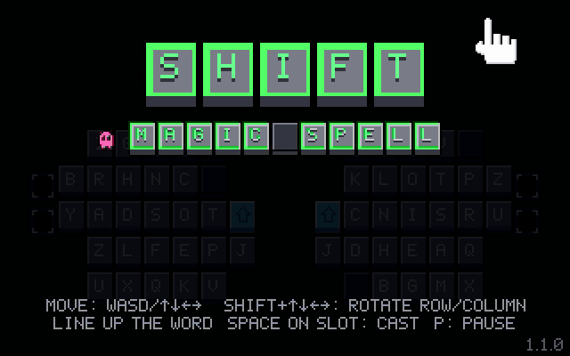
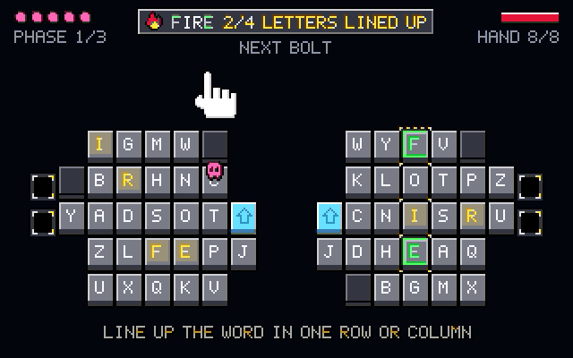
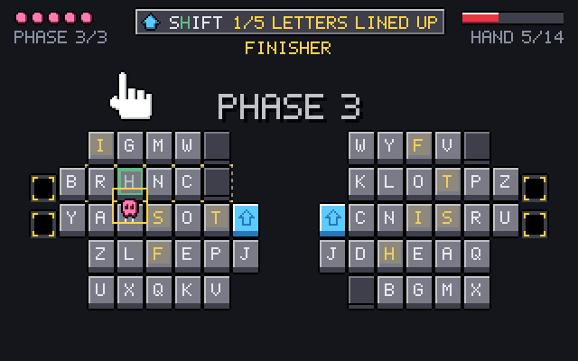

# Shift Magic Spell



**[▶ Play in your browser on itch.io](https://seolcw.itch.io/shift-magic-spell)**

A giant mouse cursor is attacking you on top of two keyboards.
You fight back with the **Shift** key: rotate the row or column you are standing on, line up a spell word like `FIRE` or `MAGIC`, and blast the cursor with it. The final blow is spelled **SHIFT**.

Made for **GitHub Game Off 2026** (theme: **SHIFT**).

- Play: [seolcw.itch.io/shift-magic-spell](https://seolcw.itch.io/shift-magic-spell) (WebGL, runs in the browser)
- Engine: Unity 6000.0.58f2, 2D (Built-in), WebGL, 320x200 pixel art scaled 3x to 960x600

## How to play

| Key | Action |
| --- | --- |
| WASD / Arrow keys | Move one key |
| **Shift + Arrow keys** | Rotate the row (←→) or column (↑↓) you stand on by one key |
| Space | On an attack slot: cast the stored spell block |
| P | Pause |
| R | Restart the current phase |
| M | Mute / unmute |
| Space / Enter / Click | Skip the ending scene |



1. **Line up the word.** The target word (top of the screen) must be spelled in one row (left → right) or one column (top → bottom). Letters never change; only their positions shift. Letter positions flash every few seconds, so keep moving and watch.
2. **Store it.** A finished word becomes a spell block in an attack slot on the **other** keyboard.
3. **Cast it.** Step on the blue Shift key to teleport to the other keyboard, walk to the slot and press Space. Casting two blocks from the same keyboard within 1.5 s is a combo (+50%).
4. **Dodge.** Every cursor attack is telegraphed in red. The cursor can also shove a whole row, smash your slots, and chase you.
5. After three phases, the final word is **SHIFT**.

The first word (`FIRE`) is a practice round: the cursor does not attack until you cast your first block.

## Features

- **Shift is the verb.** Every move that matters rotates a row or column of keys (Loopover-style). The cursor shoves rows too, so the board is always shifting under you.
- **Two keyboards, one loop.** Words finished on one keyboard are cast from the other, so you keep teleporting through the blue Shift keys.
- **17 spell words, 10 spell effects.** Fireballs, lightning, lasers, gusts, stars, ice shards, blades, a rocket and a dragon's breath.
- **A title screen that shifts.** The scrambled keycaps of SHIFT and MAGIC SPELL slide one key at a time into place, light up, and a fireball knocks the cursor away before CLICK TO START.
- **Game feel on every hit.** A short hit-stop (inputs pressed during it are kept, not dropped), a white flash on whoever got hit, screen shake in the direction of the hit, knockback and squash, flying debris, a red screen edge when you are hurt (it pulses at 1 HP), and heavier sounds for bigger hits. All strengths live in `AttackPatterns.asset > Hit Feel`, including global shake and flash multipliers.
- **An ending.** After the final SHIFT, the giant cursor cracks, flips through an hourglass and a text I-beam, shrinks into a tiny arrow, and runs off screen. It was just a stuck cursor.

  

## Building

1. Open the project folder in Unity 6000.0.58f2 (Hub → Add project).
2. Open `Assets/Scenes/Main.unity` and press Play.
3. WebGL build: **Tools → Shift Magic Spell → Build WebGL**, or from the command line:
   ```
   Unity.exe -batchmode -quit -projectPath <this folder> -buildTarget WebGL ^
     -executeMethod ShiftMagicSpell.Editor.WebGLBuildUtils.BuildFromCommandLine ^
     -buildVersion shift-magic-spell-v0.1.0.sha.<commit> -buildOutput Builds/WebGL/<name>
   ```
   - Gzip compression with Decompression Fallback off: the web server must send `Content-Encoding: gzip` for `.gz` files (itch.io does). Opening `index.html` from disk does not work.
   - The custom template `Assets/WebGLTemplates/ShiftMagicSpell` shows only the 960x600 canvas (no footer, no scroll bars).
4. itch.io: zip the build folder so `index.html` is at the top of the zip, upload it as an HTML game, set the embed size to **960 x 600**, and turn on itch.io's **Fullscreen button** (the game itself has no fullscreen button; the canvas scales to fit when the frame gets larger).

Tests: PlayMode tests in `Assets/Tests/PlayMode` (rules, bot playthroughs, input, sound, hit feedback, ending, screen captures, title screen; 78 tests plus 1 explicit video recording). Run them with the Unity Test Runner or in batch mode (`-runTests -testPlatform PlayMode`) with the editor closed. Screen captures are written to `Logs/Screens/`.

Recording the ending as a video: run the explicit test `ShiftMagicSpell.Tests.EndingVideoRecordTests.RecordEndingFrames` (`-testFilter`). It saves 30 fps frames and a log of every sound actually played to `Logs/Video/ending/`; combine them with ffmpeg (frames scaled 3x with nearest-neighbor, each sound delayed to its frame with the logged volume and pitch).

Pixel art lives in `Assets/Art/*.aseprite` and is imported directly (Aseprite Importer). The generator scripts are in `ArtSource/Scripts/` (run with Aseprite `-b --script`).

## Project docs (Korean)

- `HANDOVER.md`: current status and next steps
- `Docs/DESIGN.md`: game design (rules, numbers, assets)
- `Docs/UNITY-STRUCTURE.md`: what to edit where in the Unity project (also the **Tools → Shift Magic Spell** menu)
- `WebPrototype/`: the HTML prototype the Unity version was ported from

## Credits

- Game design, code and pixel art: seolcw
- Sound effects: made for this project with [jsfxr](https://sfxr.me/) (settings and sfxr.me links for every sound in `Assets/Audio/Sfx/README.md`)
- Music: "Chiptune Grooving" from [Pixabay](https://pixabay.com/) (uploader 8059346, audio ID 142242), used under the Pixabay Content License
- Pixel font (5x7): made for this project

## License

- The source code and the original assets made for this project (pixel art, sound effects, pixel font) are released under the [MIT License](LICENSE).
- **The music file `Assets/Audio/Music/ChiptuneGrooving.mp3` is not covered by the MIT License.** It is used under the Pixabay Content License, which does not allow redistributing the audio on its own. Do not reuse it outside this game; get it from Pixabay instead.
